<p align="center">
  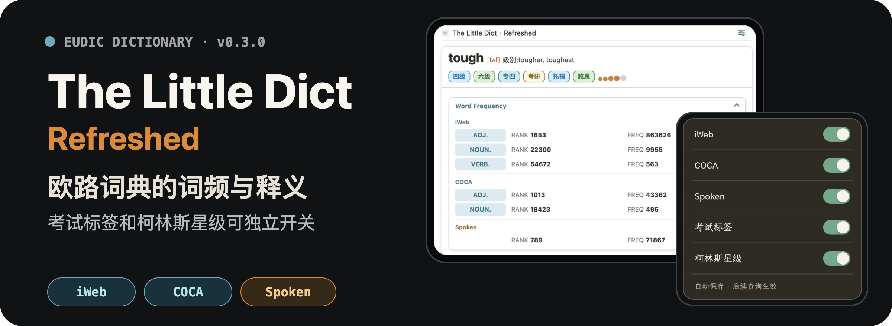
</p>

<p align="center">
  <strong>v0.3.0 · 标签和星级拆分与查词修复</strong><br>
  面向欧路词典移动端与桌面端的稳定查询与显示控制
</p>

The Little Dict · Refreshed 在保留词典正文与原始词频数据的基础上，重新整理单词、短语、词频来源与中文释义。iWeb、COCA、Spoken、Phrase Frequency、考试标签和柯林斯星级均可独立开关，设置自动保存。

## 实机效果

封面、改造对比中的 Refreshed 界面、macOS 和移动端设置与单词查询使用 v0.3.0 实机截图。短语示例来自 v0.2.x。

### 改造前后

<p align="center">
  <a href="./assets/readme/screenshots/comparison/mobile-before-after.jpg">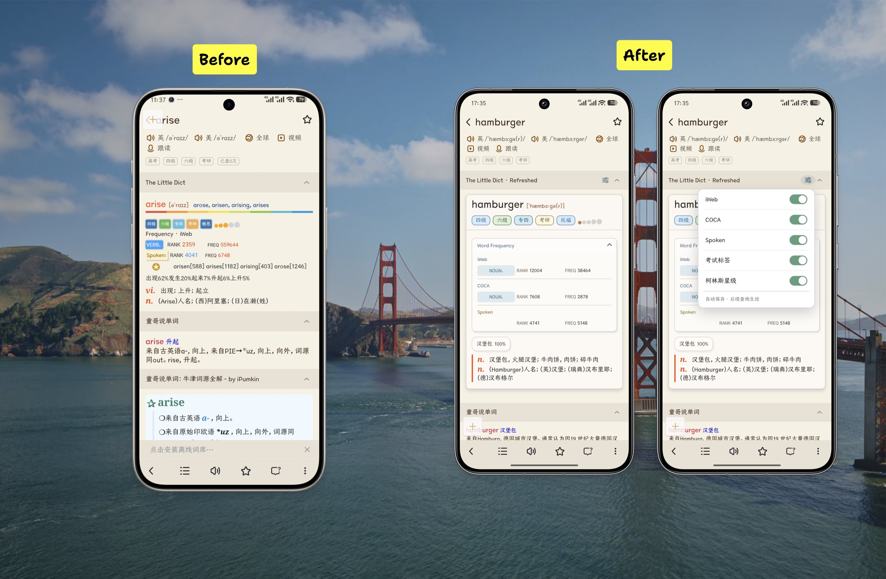</a>
</p>

<p align="center"><sub>从左到右：原版词条、v0.3.0 词频卡片、v0.3.0 显示设置（点击图片查看大图）</sub></p>

### macOS 桌面端

<p align="center">
  <a href="./assets/readme/screenshots/v0.3.0/macos-settings.png">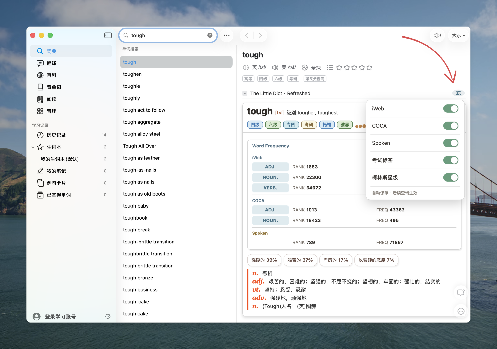</a>
</p>

<p align="center"><sub>点击词条右侧的滑杆按钮打开显示设置。点击图片可查看大图。</sub></p>

#### macOS 深色设置和词频卡片

<p align="center">
  <a href="./assets/readme/screenshots/v0.3.0/macos-settings-dark.png">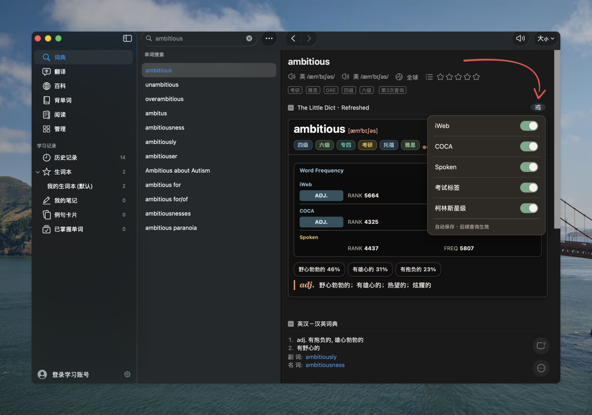</a>
</p>

<p align="center">
  <a href="./assets/readme/screenshots/v0.3.0/macos-tough.png">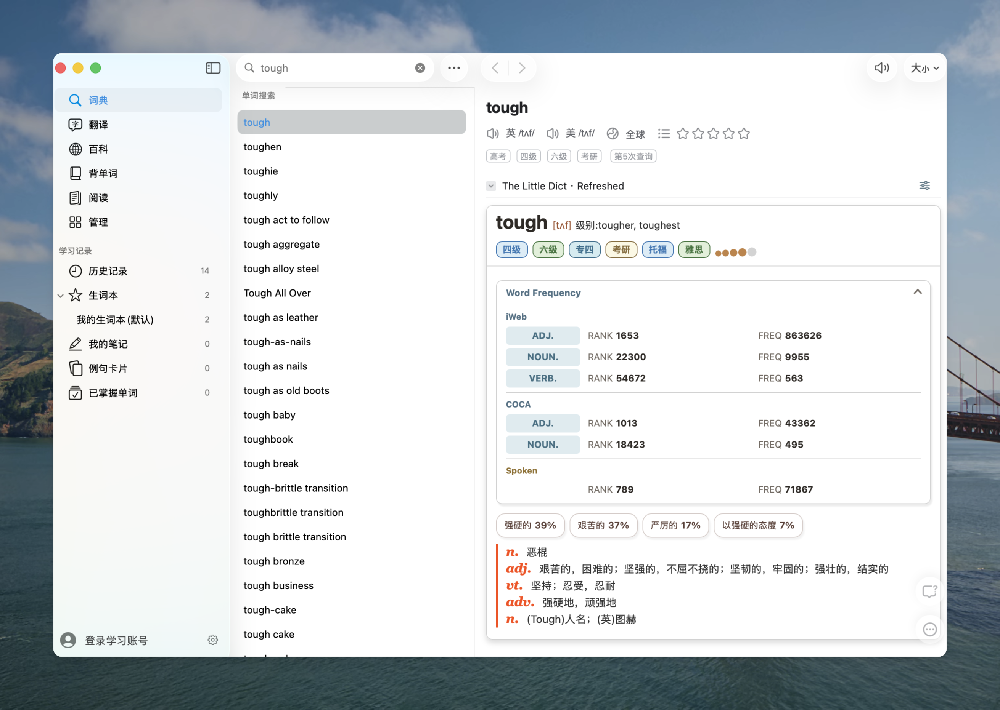</a>
  <a href="./assets/readme/screenshots/v0.3.0/macos-ambitious-dark.png">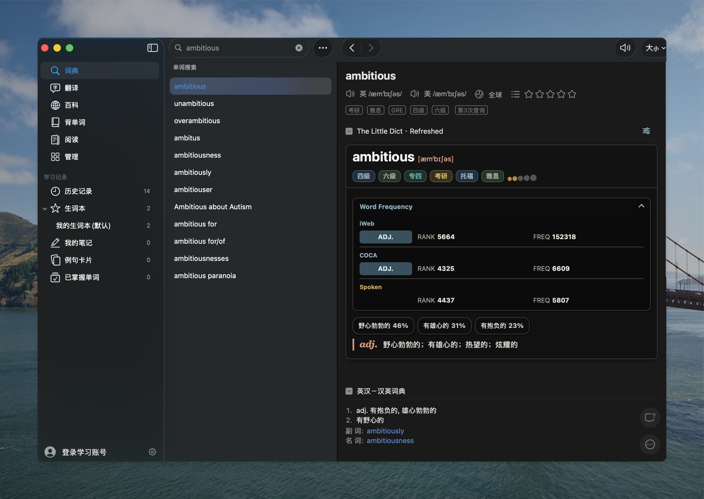</a>
</p>

<p align="center"><sub>左：tough 多词性词频　·　右：ambitious 深色词频卡片（点击图片查看大图）</sub></p>

### 移动端页面显示设置

<p align="center">
  <a href="./assets/readme/screenshots/v0.3.0/settings-light.jpg">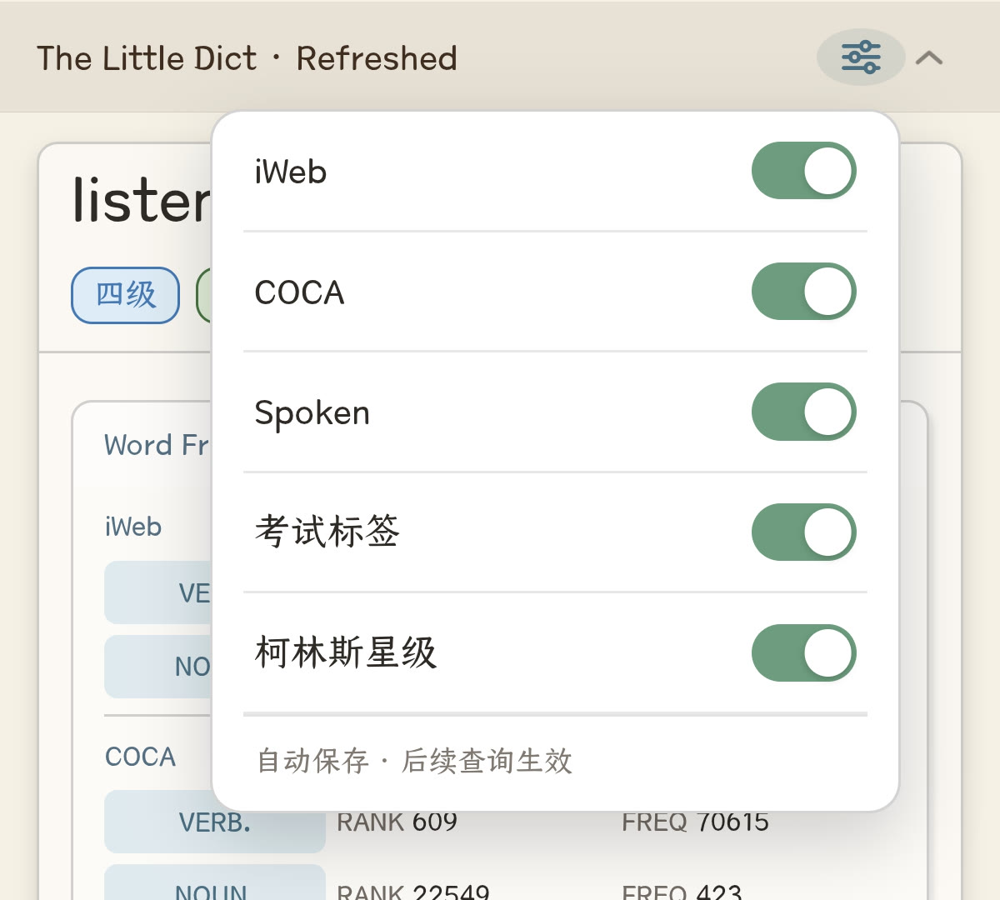</a>
  <a href="./assets/readme/screenshots/v0.3.0/settings-dark.jpg">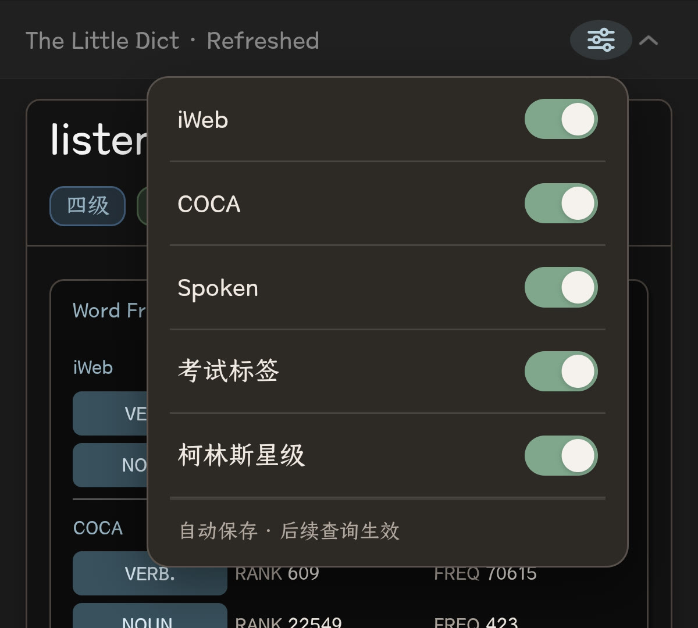</a>
</p>

<p align="center"><sub>左：浅色模式　·　右：深色模式（点击图片查看大图）</sub></p>

### 移动端单词查询

<p align="center">
  <a href="./assets/readme/screenshots/v0.3.0/listen-light.jpg">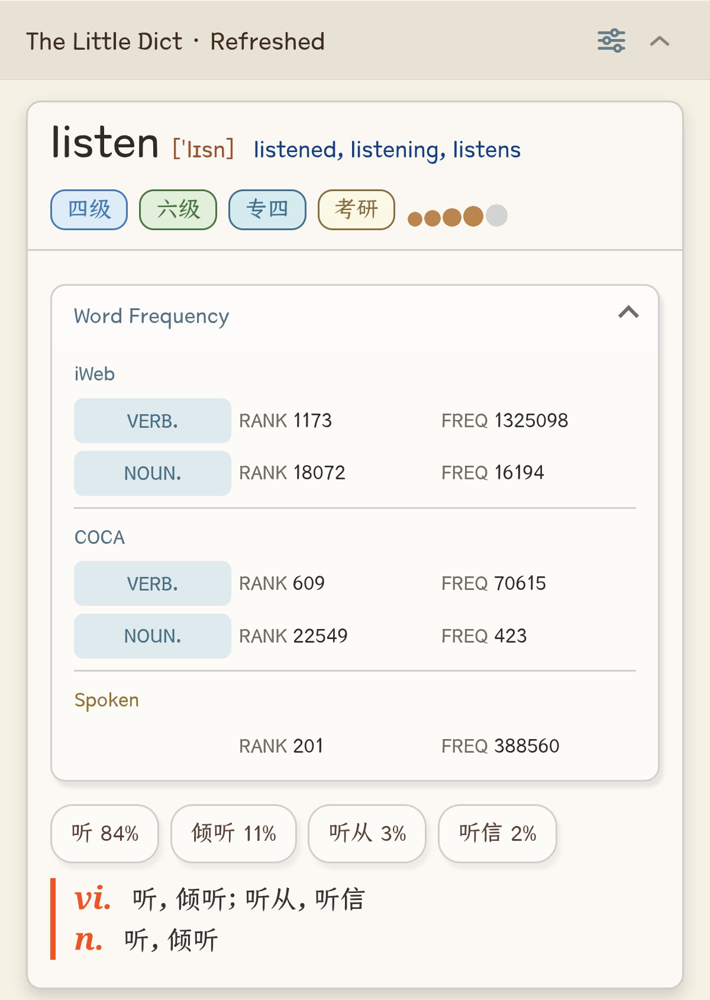</a>
  <a href="./assets/readme/screenshots/v0.3.0/listen-dark.jpg">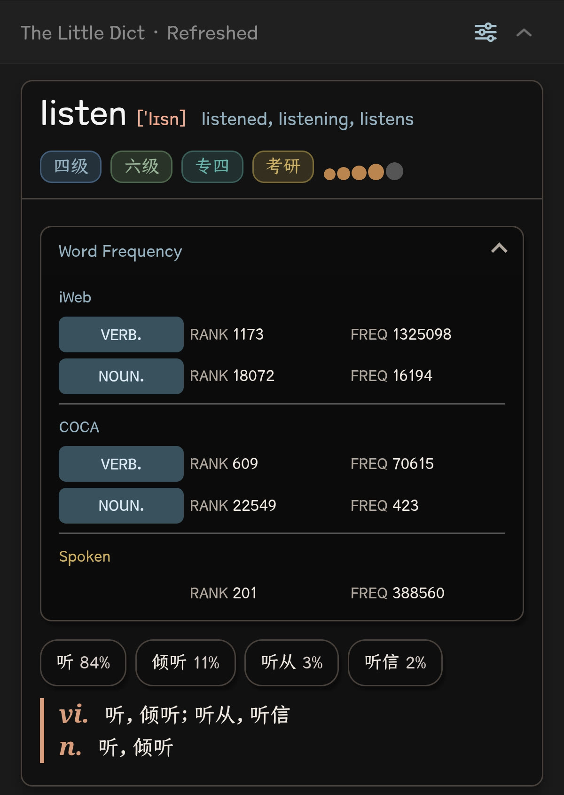</a>
</p>

<p align="center"><sub>左：浅色模式　·　右：深色模式（点击图片查看大图）</sub></p>

`secure` 的星级圆点整组移到考试标签下方。

<p align="center">
  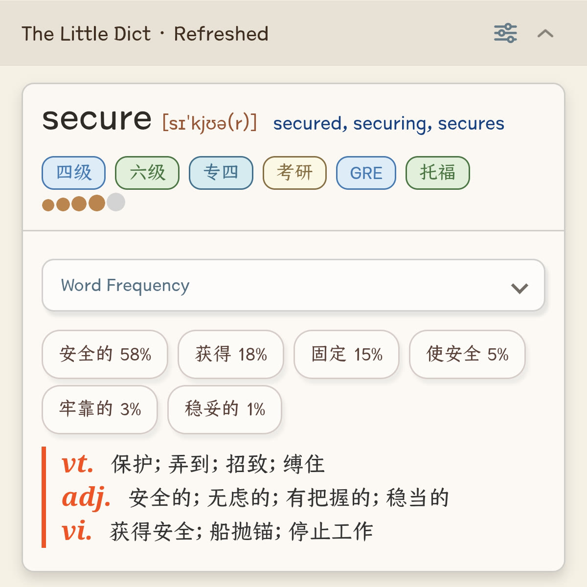
</p>

### 移动端短语与相邻同形词查询

<p align="center">
  <a href="./assets/readme/screenshots/go-on-light.png">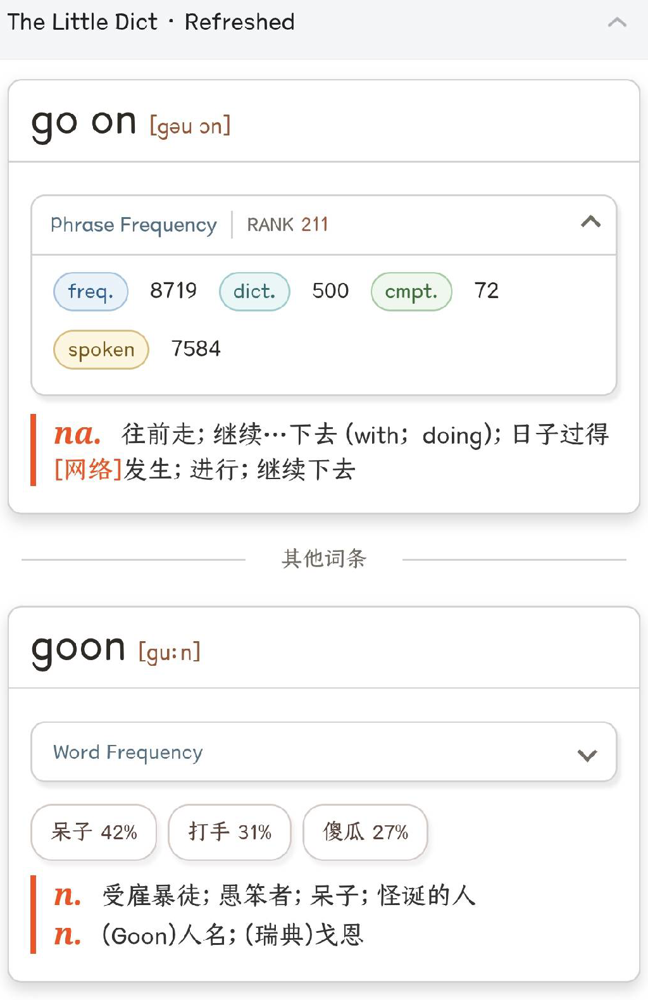</a>
  <a href="./assets/readme/screenshots/go-on-dark.png">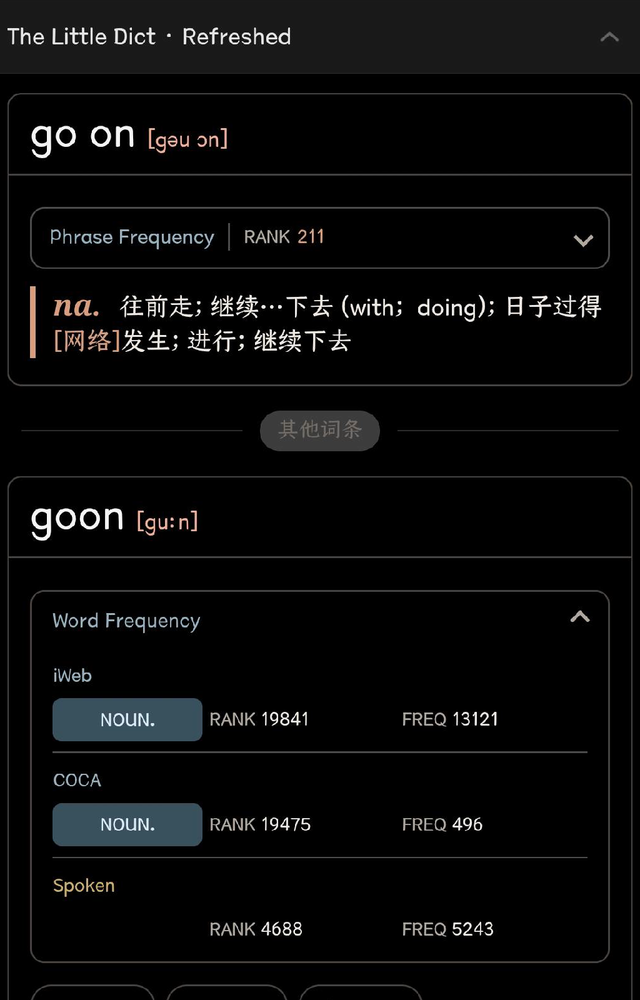</a>
</p>

<p align="center"><sub>左：浅色模式　·　右：深色模式（点击图片查看原尺寸）</sub></p>

## v0.3.0 包含什么

- 单词词频统一为 `iWeb → COCA → Spoken` 三来源卡片；
- 短语保留 `RANK`、`freq.`、`dict.`、`cmpt.` 与 `spoken` 数据；
- Phrase Frequency 与相邻同形词的 Word Frequency 分开呈现；
- 隐藏卡片内的词性占比条，保留卡片下方的释义占比胶囊；
- 可独立控制 iWeb、COCA、Spoken、Phrase Frequency、考试标签和柯林斯星级；
- 当前查询没有对应内容时自动省略设置项，修改后立即生效并自动保存；
- 设置浮层保持在视口内，点击页面其他位置即可关闭；
- 修复点击词典标题和音标时的误跳词，以及查词时词头位置和字号跳动。点击标题可展开或折叠词典；
- 窄屏空间不足时，柯林斯星级圆点整组换行；
- 适配 320–720 CSS px、浅色模式与深色模式。

## 安装

请从 [v0.3.0 Release](https://github.com/M3tar/The_Little_Dict_Refreshed/releases/tag/v0.3.0) 的 Assets 下载 `TLD_Refreshed_v0.3.0.zip` 并完整解压。解压目录内的五个文件为 `TLD.mdx`（词典正文）、`TLD.png`（图标）、`config.ini`（配置）、`fy.js`（脚本）和 `p.css`（样式）。

在欧路词典配置「外部引用词库路径」时，请选择这个解压目录。 [欧路扩充词库说明](https://docs.eudic.net/1/shi-yong-zhi-yin/tian-jia-kuo-chong-ci-ku)

**安装词库后，请清理欧路词典的缓存，再重新打开应用查词。** 旧缓存可能让页面继续显示旧样式或旧设置。

请勿下载 GitHub 自动生成的 `Source code (zip)`，其中没有词典正文。

### 为什么仓库中没有 TLD.mdx？

`TLD.mdx` 体积较大，不适合加入 Git 历史。稳定版本通过 GitHub Release 提供包含词典正文和配套界面文件的完整安装包。

## 显示配置

`config.ini` 提供首次导入时的默认显示设置。已保存的页面偏好优先。

升级时，考试标签和柯林斯星级先继承旧版合并开关的已保存状态，之后分别保存。旧版 `config.ini` 缺少 `collins_stars` 时，星级的首次使用默认值沿用 `exam`。

| 配置项 | 默认值 | 作用 |
| --- | ---: | --- |
| `freq_expand` | `0` | Word Frequency 默认折叠；`1` 展开，`2` 隐藏 |
| `phrase_freq_expand` | `0` | Phrase Frequency 默认折叠；`1` 展开 |
| `iweb` | `1` | 显示 iWeb 来源 |
| `coca` | `1` | 显示 COCA 来源 |
| `spoken` | `1` | 显示 Spoken 来源 |
| `EPFD` | `1` | 显示 Phrase Frequency |
| `exam` | `1` | 显示考试标签 |
| `collins_stars` | `1` | 显示柯林斯星级 |
| `ex_ratio` | `1` | 显示卡片下方的释义占比胶囊 |
| `definition` | `1` | 显示按词性分组的中文释义 |
| `dark_mode` | `0` | 跟随宿主；`1` 浅色，`2` 深色 |

完整说明见 [`config.ini`](./config.ini)。

## 项目文件

```text
TLD.mdx       完整发布包中的词典正文（不纳入 Git 仓库）
TLD.png       词典图标
config.ini    默认显示配置
fy.js         DOM 解析、重组与交互
p.css         布局、主题与响应式样式
```

`TLD.mdx` 和完整发布包体积较大，不作为普通 Git 文件提交。公开分发前还需单独确认词典正文的授权范围。

## 验证状态

- v0.3.0 正式安装包已通过 Android、iPhone 和电脑版欧路实机验收；
- 本地 Chromium 50 组回归通过，混合缓存和设置浮层专项通过；
- 覆盖宽度：320、360、375、390、430、720 CSS px；
- 正式包：不含测试编号，包内资源与已验收源码一致。

## 路线图

**v0.3.0 · 标签和星级拆分与查词修复（当前版本）**

考试标签和柯林斯星级可独立开关，空间不足时星级整组换行，并修复点击词典标题或音标误跳词、查词时词头跳动的问题。

**v0.2.1 · 桌面兼容更新**

兼容 macOS 欧路桌面端的标题结构，使页面显示设置在移动端与桌面端均可正常使用。

**0.2.0 · 可配置查询版**

在 0.1.0 的稳定查询基础上，加入五项独立显示开关、内容感知设置项、自动保存与浮层交互。

**0.1.0 · 稳定查询版**

完成单词、短语、三来源词频、相邻同形词、释义占比胶囊及响应式深色模式的稳定显示。

**下一阶段**

尚未定义。后续功能会继续以不修改词典正文和原始词频数据为前提，并在开发前单独确认范围。

## 开发约束

项目不修改词典释义、词频原始数值或语料统计口径。`fy.js` 负责稳定渲染与交互，`p.css` 负责布局和主题，`config.ini` 只提供默认开关值。
